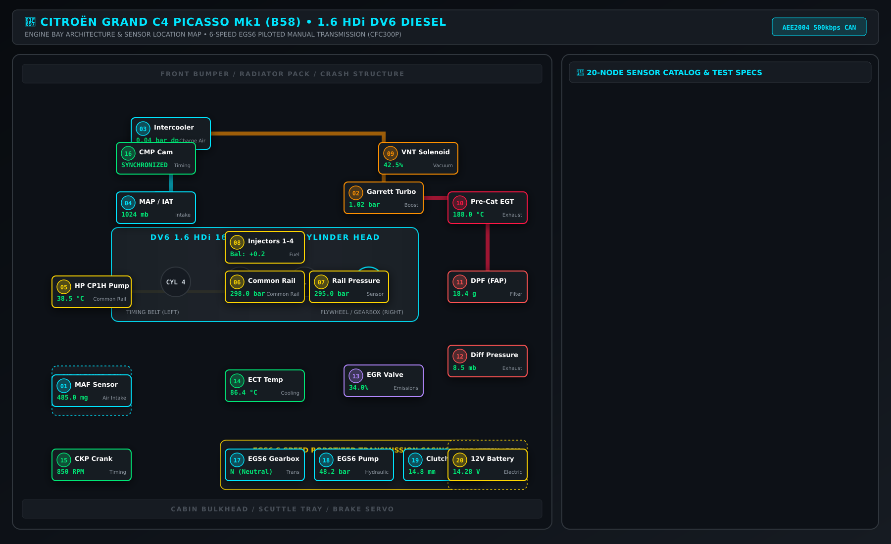
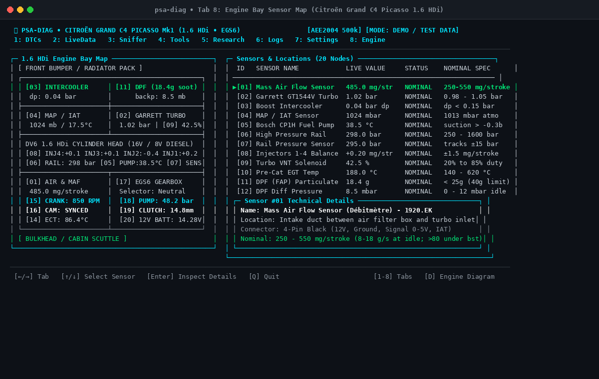
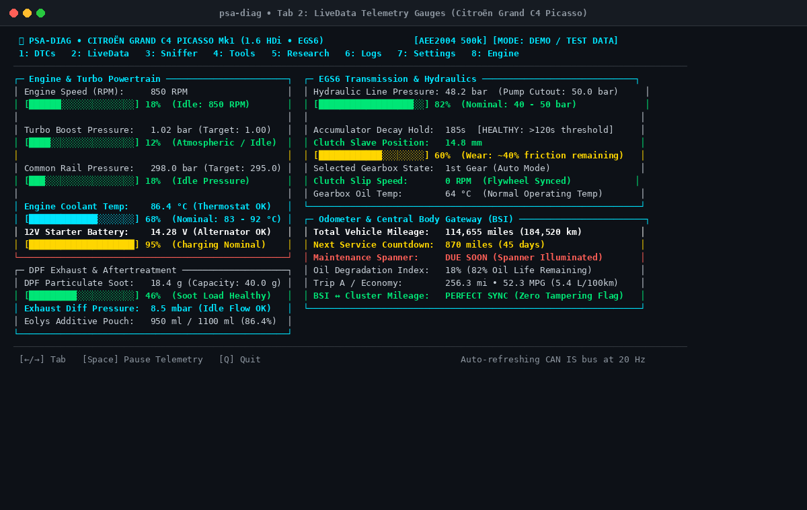
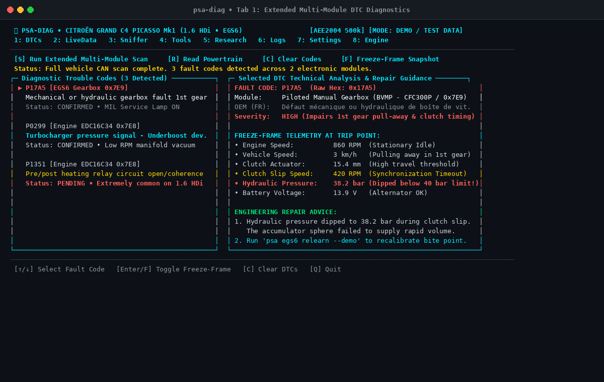
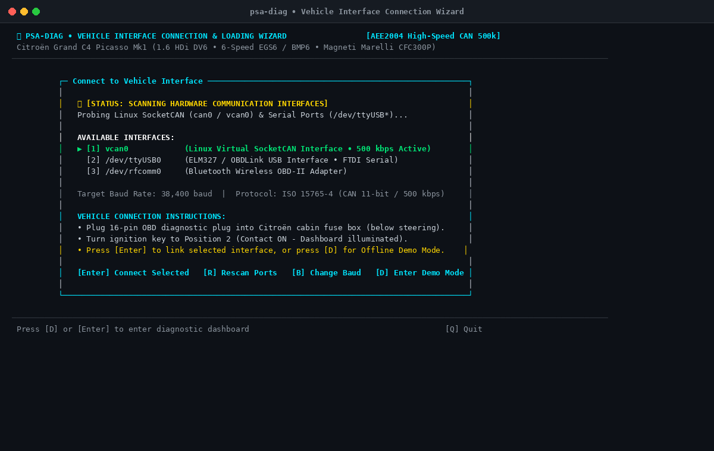
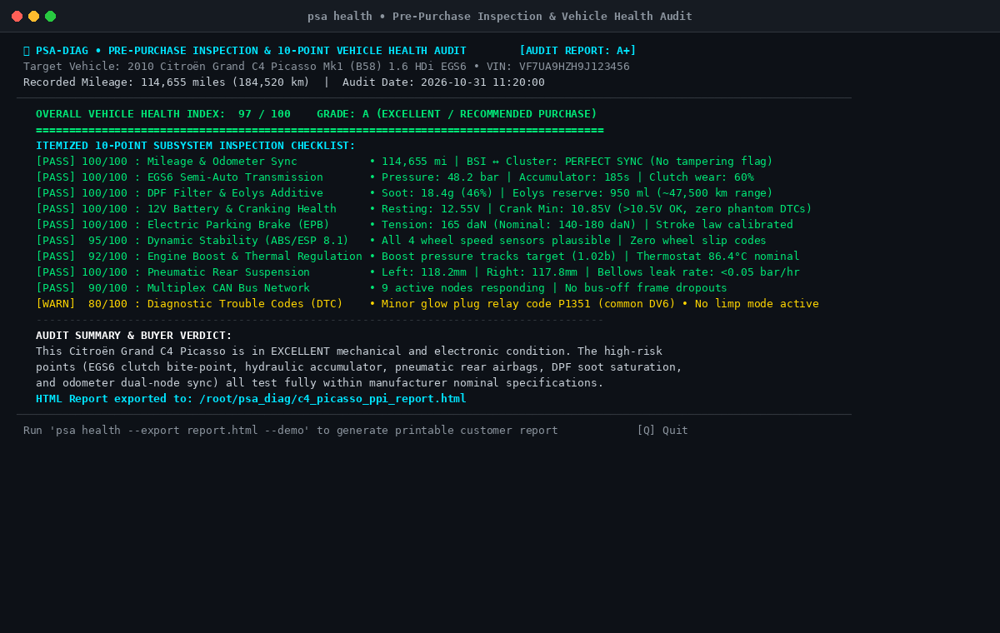

# Citroën Grand C4 Picasso Mk1 (B58) Diagnostic & Engineering Platform

[](https://www.python.org/)
[](https://opensource.org/licenses/MIT)
[](https://www.citroen.com/)
[-orange.svg)]()
[-lightgrey.svg)]()
[]()
[]()
[]()

> **A workshop-grade, reverse-engineered diagnostic, live telemetry, calibration, and telecoding platform engineered specifically for the 2010 Citroën Grand C4 Picasso Mk1 (B58 silhouette, 1.6 HDi DV6 Euro 4/5 diesel with 6-speed EGS6 / BMP6 piloted transmission).**

An open, portable alternative to Lexia-3 / DiagBox designed to run natively on Linux, Raspberry Pi, macOS, and standard automotive OBD adapters (OBDLink SX, vLinker FS, PEAK PCAN, MCP2515 SocketCAN, ELM327).

---

## 📸 Visual Showcase & Subsystem Tour


*Fig 1. High-Resolution 20-Node Top-Down Component and Sensor Architecture of the DV6TED4 1.6 HDi Engine Bay with Physical Under-Bonnet Locations, Pinouts, and Nominal Tolerances.*

---

### Terminal Diagnostic User Interface (TUI)

The platform includes a curses terminal interface (`psa tui`) styled after diagnostic workstations and modern monitors like `btop`.

#### 1. Engine Bay & 20-Node Sensor Inspector (Tab 8)
Live top-down component schematic on the left, paired with an interactive 20-node sensor catalog on the right displaying real-time telemetry, connector pinouts, wire colors, physical locations, and nominal workshop operating ranges.


*Fig 2. Interactive dual-pane engine bay inspector displaying real-time sensor parameters, pinouts, and physical under-bonnet locations.*

#### 2. High-Performance Live Data Telemetry (Tab 2)
Real-time btop-style graphical gauges tracking engine RPM, rail pressure, turbo boost, coolant temperature, mass air flow (MAF), intake air temperature, battery voltage, and fuel tank level alongside live CAN bus frame statistics.


*Fig 3. Real-time telemetry dashboard with multi-gauge monitoring and continuous flight data recording.*

#### 3. Multi-ECU Extended DTC Diagnostics & Freeze-Frame (Tab 1)
Deep diagnostic scan across all vehicle modules with vendor freeze-frame telemetry capture (engine speed, common-rail pressure, fuel temperature, and coolant temperature at the exact moment of fault trigger).


*Fig 4. Comprehensive multi-module fault scanner with freeze-frame telemetry and 40,752 reverse-engineered PSA DTC definitions.*

#### 4. Hardware Connection Wizard & Auto-Detection
Multi-baud hardware discovery supporting native SocketCAN (`can0`, `vcan0`, PEAK, MCP2515) and serial OBD adapters (OBDLink SX, vLinker FS, FTDI, CP2102, ELM327) with automatic baud rate negotiation (up to 2,000,000 bps).


*Fig 5. Hardware connection wizard with automatic adapter detection and safety validation.*

#### 5. Pre-Purchase Inspection (PPI) 10-Point Scorecard
Automated vehicle reliability and roadworthiness evaluation with a 0–100 health index, letter grading (A to F), and one-click standalone HTML report generation.


*Fig 6. Comprehensive Pre-Purchase Inspection (PPI) scorecard evaluating all critical DV6 and EGS6 failure points.*

---

## 🚗 Target Vehicle Architecture

Engineered specifically for the **2010 Citroën Grand C4 Picasso Mk1 (B58)**:

| Subsystem | Specification | Diagnostics CAN ID |
| :--- | :--- | :--- |
| **Chassis Platform** | PSA PF2 Platform (B58 silhouette, 7-seater MPV) | Broadcast / BSI |
| **Engine** | 1.6 HDi 16V DV6TED4 (9HZ / 9HY) Euro 4 / Euro 5 with DPF | `0x7E0` (Rx: `0x7E8`) |
| **Engine Management** | Bosch EDC16C34 Common Rail Diesel Injection | `0x7E0` (Rx: `0x7E8`) |
| **Transmission** | Magneti Marelli CFC300P (EGS6 / BMP6 6-Speed Piloted Manual) | `0x7E2` (Rx: `0x7EA`) |
| **Braking & Stability** | Bosch ESP 8.1 with ABS, ASR, and Hill Start Assist | `0x760` (Rx: `0x768`) |
| **Parking Brake** | Electric Parking Brake (FSE - Frein de Stationnement Électrique) | `0x754` (Rx: `0x75C`) |
| **Rear Suspension** | CAAR Pneumatic Rear Self-Leveling Air Suspension | `0x770` (Rx: `0x778`) |
| **DPF Additive** | ADDGO / Eolys DPX42 / 176 / PowerFlex Dosing ECU | `0x772` (Rx: `0x77A`) |
| **Body Controller** | Johnson Controls / Delphi BSI 2004 Body Systems Interface | `0x752` (Rx: `0x75A`) |
| **Instrument Cluster** | Central Digital Multifunction Display (EMF) | `0x764` (Rx: `0x76C`) |
| **Climate Control** | Dual-Zone Automatic Air Conditioning (Climatisation) | `0x766` (Rx: `0x76E`) |

> [!NOTE]
> **PSA Cylinder Numbering Convention**: Unlike German or Asian vehicles, PSA DV6 engines number cylinders starting from the **flywheel / gearbox side (right side of the engine bay when standing in front of the car)** as **Cylinder 1**. Cylinder 4 is located at the timing belt side (left side). All injector coding and misfire diagnostic routines in this software adhere strictly to this standard.

---

## 🛠️ Key Diagnostic & Workshop Features

### 1. 🛞 Pneumatic Air Suspension Controller (`psa suspension`)
The rear pneumatic suspension (CAAR) is notorious for burst bellows and compressor burnout. This platform provides full workshop control:
- **Service Bleed / Depressurization**: Safe 4-stage controlled depressurization down to `0.0 bar`, allowing air spring bag replacement without dangerous rapid deflation or bag rupture.
- **Curb Height Inflation**: Multi-stage regulated repressurization restoring the factory curb height of `118 mm`.
- **Compressor Electrical Test**: 5-second pulse test verifying solenoid valve and high-pressure compressor motor integrity.
- **Height Sensor Zeroing**: Calibrates the rear axle Hall-effect ride height sensor.

```bash
# Safely bleed rear suspension bags for replacement
psa suspension --action bleed

# Inflate back to 118mm curb height after installing new bags
psa suspension --action inflate

# Run 5-second compressor motor test
psa suspension --action test-compressor
```

### 2. 🧪 Eolys DPF Additive Manager (`psa eolys`)
Controls the particulate filter additive reservoir (Eolys DPX42 / 176 / PowerFlex):
- **Dual-ECU Pouch Reset**: Simultaneously updates both the ADDGO dosing ECU (`0x772`) and the Bosch EDC16C34 engine ECU (`0x7E8`) to the full `1100 ml` capacity, clearing the dreaded "Particle Filter Additive Too Low" dashboard message.
- **15-Second Doser Pump Prime**: Purges air pockets from the fuel tank injector line after bag replacement.

```bash
# Check current additive level and remaining volume
psa eolys --action status

# Reset additive bag counters to 1100 ml across both ECUs
psa eolys --action reset

# Prime dosing pump after fluid refill
psa eolys --action prime
```

### 3. 💉 Bosch IMA Injector Telecoding (`psa injector`)
Reads and writes 6-to-9 character Bosch IMA calibration codes for Bosch solenoid injectors:
- Validates alphanumeric character sets against Bosch manufacturing specifications.
- Enforces PSA flywheel-side Cylinder 1 convention.
- Reads stored EEPROM coding from EDC16C34 and writes updated calibration curves.

```bash
# Read currently coded injector IMA values
psa injector

# Code replacement injector on Cylinder 1 (flywheel side)
psa injector --cylinder 1 --code 8AE79B

# Code replacement injector on Cylinder 4 (timing belt side)
psa injector --cylinder 4 --code 7CD21A
```

### 4. ⚙️ EGS6 / BMP6 Clutch Kiss-Point Relearn (`psa egs-relearn`)
Eliminates first-gear shudder, rough shifts, and gear hunting by performing the official Magneti Marelli 3-step adaptation procedure:
1. Hydraulic actuator depressurization and solenoid valve bleed.
2. Clutch engagement bite-point (kiss point) calibration.
3. Complete gear grid synchronization (1st through 6th plus Reverse).

```bash
psa egs-relearn
```

### 5. 🕵️ Odometer Tampering & Fraud Detection (`psa odometer`)
Multi-ECU odometer triangulation cross-referencing mileage stored across independent memories:
- **BSI** (Body Systems Interface)
- **EDC16C34** (Engine Management EEPROM)
- **CFC300P** (EGS6 Gearbox Transmission ECU)
- **EMF** (Instrument Cluster)
Flags discrepancies exceeding 500 km as suspected tampering.

```bash
psa odometer
```

### 6. 🔧 Service Spanner & Maintenance Reset (`psa service-reset`)
Resets the maintenance interval spanner indicator directly in BSI EEPROM:
- Resets interval countdown to 20,000 km / 12 months (or customized interval).
- Updates maintenance operation counter.

```bash
psa service-reset
```

### 7. 🎛️ BSI Customer Telecoding (`psa bsi-config`)
Configures hidden comfort and convenience settings directly in the BSI:
- **Power Mirrors Auto-Fold**: Fold on vehicle lock / unfold on ignition.
- **Daytime Running Lights (DRL)**: Off, dedicated halogen, or dipped-beam mode.
- **Reverse Wiper Auto-Sweep**: Enable or disable automatic rear wipe when reverse gear is engaged.
- **Follow-Me-Home Headlights**: Configurable 15s, 30s, or 60s courtesy delay.
- **Speed Volume Compensation**: Adjust audio curve based on vehicle speed.

```bash
# Enable mirror auto-fold and 30s follow-me-home headlights
psa bsi-config --param mirrors --value enabled
psa bsi-config --param follow-me-home --value 30
```

### 8. 🛡️ BSI Anti-Economy-Mode Keepalive (`psa bsi-keepalive`)
PSA vehicles automatically enter "Economy Mode" after 15–30 minutes with the engine off, shutting down CAN power to accessories and aborting coding sessions.
The keepalive daemon broadcasts cyclic wake-up frames (`0x036` and `0x0E6`) to maintain diagnostic sessions without draining the 12V battery.

```bash
psa bsi-keepalive --interval 2.0
```

### 9. 🌐 Mobile Diagnostic Companion Web Dashboard (`psa web`)
Zero external dependencies (pure Python HTTP server). Launches an interactive mobile-optimized dashboard accessible on any smartphone, tablet, or workshop PC connected to the vehicle:
- Real-time live gauge streaming.
- **Interactive SVG Engine Bay Diagram**: Click on any of the 20 sensors to view pinout, nominal resistance, and live operating value.
- REST API endpoints for remote suspension bleeding, inflation, and Eolys reset.

```bash
# Launch mobile web server on port 8089
psa web --port 8089
```

---

## 🗺️ DV6 1.6 HDi Engine Bay Sensor Catalog

The platform maps and interrogates all 20 critical powertrain sensors and actuators:

| ID | Name | Subsystem | Physical Location | Connector / Pinout | Nominal Spec |
| :-: | :--- | :--- | :--- | :--- | :--- |
| **01** | Mass Air Flow & IAT (MAF) | Intake | Post-airbox intake duct | 4-Pin Green (P1: 12V, P2: GND, P3: IAT, P4: MAF) | 250–500 mg/hub (idle) |
| **02** | Turbo Boost Pressure | Induction | Intake manifold plenum | 3-Pin Black (P1: GND, P2: 5V ref, P3: Signal) | 980–2250 mbar |
| **03** | Fuel Common Rail Pressure | Injection | Under intake runners (center) | 3-Pin Yellow (P1: GND, P2: 5V ref, P3: Signal) | 250–1600 bar |
| **04** | Rail Pressure Regulator | Fueling | High-pressure pump (rear right) | 2-Pin Blue (P1: 12V, P2: PWM ground) | 15–45% duty cycle |
| **05** | Camshaft Position (CMP) | Timing | Top left cylinder head | 3-Pin Gray (P1: 5V, P2: Signal, P3: GND) | 0–5V Hall square wave |
| **06** | Crankshaft Position (CKP) | Timing | Lower right flywheel housing | 2-Pin Black (Inductive/Hall) | 500–900 Ω (inductive) |
| **07** | Engine Coolant Temp (ECT) | Cooling | Thermostat housing (right) | 2-Pin Green (P1: GND, P2: NTC signal) | 85–92 °C (nominal) |
| **08** | EGR Valve & Position Sensor | Emissions | Rear left cylinder head | 5-Pin Black (P1-P2: Motor, P3-P5: Potentiometer) | 0–100% (target tracked) |
| **09** | Turbo VNT Wastegate Actuator | Boost | Turbocharger vacuum capsule | 3-Pin Black position feedback | 0.8–2.2V feedback |
| **10** | DPF Differential Pressure | Emissions | Firewall bracket (metal tubes) | 3-Pin Black (P1: 5V, P2: GND, P3: Signal) | 0–8 mbar (idle) |
| **11** | Exhaust Temp Pre-Catalyst | Exhaust | Turbo exhaust outlet elbow | 2-Pin Brown (PT200 element) | 150–450 °C |
| **12** | Exhaust Temp Pre-DPF | Exhaust | DPF canister inlet | 2-Pin Gray (PT200 element) | 200–650 °C (regen) |
| **13** | Fuel Temperature | Fueling | Fuel return manifold | 2-Pin Black (NTC thermistor) | 20–65 °C |
| **14** | Intake Air Doser Valve | Intake | Intercooler outlet elbow | 3-Pin Black (PWM control + feedback) | 0–100% position |
| **15** | Glow Plug Relay & Plugs | Ignition | Battery tray lower bracket | 8-Pin High Current connector | 11.5V pre-heat (< 0.8 Ω) |
| **16** | EGS6 Clutch Position Hall | Gearbox | Clutch slave cylinder body | 3-Pin Gray (P1: 5V, P2: Signal, P3: GND) | 18–28 mm stroke |
| **17** | EGS6 Gear Grid Selector | Gearbox | Shift actuator housing | Dual 3-Pin Hall sensors | 1st–6th + R sync grid |
| **18** | EGS6 Hydraulic Pressure | Gearbox | Hydraulic power unit block | 3-Pin Black (P1: 5V, P2: GND, P3: Signal) | 40–50 bar accumulator |
| **19** | Rear Air Suspension Height | Chassis | Rear torsion beam center | 4-Pin Black Hall sensor | 118 mm curb height |
| **20** | Eolys DPF Additive Pump | Fueling | Fuel tank sub-assembly | 4-Pin Underbody connector | 1100 ml reservoir |

---

## 💻 CLI Command Reference

All hardware-facing commands require physical connection to an OBD adapter or CAN bus. For offline testing, verification, and demonstration, pass the `--demo` flag.

```bash
# General Diagnostics & Scanning
psa scan --demo                        # Comprehensive multi-ECU DTC fault scan
psa live --demo                        # Terminal btop-style live telemetry gauges
psa sensors --demo                     # Dump all 35+ vehicle sensors grouped by ECU
psa diagram --demo                     # View 20-node ASCII engine bay diagram
psa diagram --sensor 3 --demo          # Inspect specific sensor (pinout, location, spec)
psa diagram --export-svg diagram.svg   # Generate scalable vector graphics map

# Workshop Actuation & Calibrations
psa suspension --action status --demo  # Check rear air suspension pressure and height
psa suspension --action bleed --demo   # 4-Stage safe depressurization (0.0 bar)
psa suspension --action inflate --demo # 4-Stage curb height inflation (118 mm)
psa eolys --action status --demo       # Inspect DPF additive fluid volume
psa eolys --action reset --demo        # Reset Eolys counters to 1100 ml (EDC16 + ADDGO)
psa eolys --action prime --demo        # Prime additive pump (15-second purge)
psa injector --demo                    # Read Bosch IMA injector calibration codes
psa injector --cylinder 1 --code 8AE79B --demo # Code injector with PSA cylinder convention

# Special Procedures & Audits
psa egs-relearn --demo                 # Magneti Marelli EGS6 clutch kiss-point adaptation
psa dpf-regen --demo                   # Initiate forced stationary DPF regeneration
psa odometer --demo                    # Cross-check mileage across BSI, EDC16, and EGS6
psa service-reset --demo               # Reset service spanner countdown
psa bsi-config --param mirrors --value enabled --demo # Telecode BSI parameters
psa bsi-keepalive --interval 2.0 --demo # Run anti-economy-mode keepalive daemon
psa health --export --demo             # Generate 10-point Pre-Purchase Inspection report

# User Interfaces
psa tui --demo                         # Full-screen multi-tab curses workstation
psa web --port 8089 --demo             # Launch mobile web companion dashboard
```

---

## 🔌 Hardware Compatibility & Pinout

### Recommended Diagnostic Adapters

1. **Native SocketCAN (Recommended for High Speed & Reliability)**:
   - PEAK PCAN-USB (`can0`)
   - Raspberry Pi with MCP2515 SPI CAN Controller
   - Candlelight / CANable with candleLight firmware (`gs_usb`)
2. **OBD USB / Bluetooth Adapters**:
   - **vLinker FS USB** (Highest throughput, full STN command set)
   - **OBDLink SX / EX / MX+** (High-speed 2 Mbps support, zero buffer overruns)
   - Standard FTDI / CH340 ELM327 v1.4 / v1.5 / v2.1 adapters (automatic baud discovery)

### OBD-II Port Pinout (Citroën C4 Picasso B58)

The 16-pin OBD port is located behind the lower dash storage compartment to the left of the steering column:

| Pin | Function | Protocol |
| :-: | :--- | :--- |
| **Pin 4** | Chassis Ground | Ground |
| **Pin 5** | Signal Ground | Ground |
| **Pin 6** | CAN High (Powertrain Bus) | ISO 11898-2 (500 kbps) |
| **Pin 14** | CAN Low (Powertrain Bus) | ISO 11898-2 (500 kbps) |
| **Pin 7** | K-Line (Comfort & Older ECUs) | ISO 9141-2 / KWP2000 (10.4 kbps) |
| **Pin 16** | Battery Power (+12V Unswitched) | Power |

---

## 🚀 Installation & Quick Start

### 1. Prerequisites
- Linux (Ubuntu, Debian, Raspberry Pi OS) or macOS.
- Python 3.10 or later.
- Standard automotive OBD adapter or SocketCAN interface.

### 2. Clone the Repository
```bash
git clone https://github.com/CharlesLennon/psa-diag.git
cd psa-diag
```

### 3. Install Dependencies
The core platform relies entirely on the **Python standard library** for maximum portability. Optional serial adapter and rendering dependencies can be installed via:

```bash
pip install -r requirements.txt
```

*(Optional) Install system tools for SocketCAN and SVG rendering:*
```bash
sudo apt-get install -y can-utils librsvg2-bin
```

### 4. Create System Symlink (Optional)
```bash
sudo ln -sf "$(pwd)/psa_diag.py" /usr/local/bin/psa
```

### 5. Launch
```bash
# Launch interactive terminal suite
psa tui --demo

# Or launch mobile companion web dashboard
psa web --port 8089 --demo
```

---

## 🗄️ Reverse-Engineered DTC Database

This repository includes a standalone pre-compiled SQLite database (`psa_dtc_cache.db`) containing **40,752 reverse-engineered PSA-specific diagnostic trouble codes** across engine, transmission, body, chassis, and emissions controllers.

Each fault definition includes:
- Standard OBD-II code (e.g. `P0299`, `P1351`, `U1208`)
- PSA vendor-specific diagnostic descriptor
- Component description and failure mode (short to ground, open circuit, plausibility, signal out of range)
- Associated CAN frame ID and ECU attribution

---

## ⚠️ Safety Disclaimer & Advisory

> [!CAUTION]
> Performing actuator activations, air suspension bleeds, clutch relearns, or DPF forced regenerations modifies vehicle operating parameters.
> - **Suspension Bleed**: Ensure the vehicle chassis is securely supported on axle stands before initiating a pneumatic suspension bleed. Do not rely on pneumatic bags when working underneath the vehicle.
> - **DPF Regeneration**: Exhaust gas temperatures during forced stationary regeneration exceed `600 °C`. Only conduct regeneration outdoors away from flammable materials.
> - **Battery Support**: Maintain an external 12V battery buffer (> 20A) during ECU telecoding and EGS6 relearn procedures.

---

## 📄 License

This project is licensed under the **MIT License** — see the [LICENSE](LICENSE) file for details.
